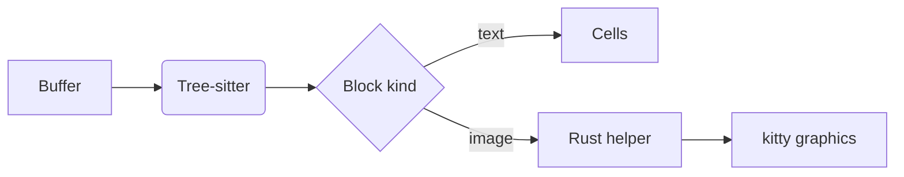

# Release notes

The preview renders **bold**, *italic*, `code`, ~~strikethrough~~, and
[links](https://github.com/jhoskin/neovim-kitty-markdown) in terminal
cells, with GitHub's palette.

> [!NOTE]
> Images and diagrams are real pixels, drawn through the kitty graphics
> protocol.


## Checklist

- [x] Tables, alerts, and footnotes[^1]
- [x] Inline math such as $x^2 + y^2 = r^2$
- [ ] World domination

| Feature  | Text | Pixels |
| -------- | :--: | -----: |
| Markdown |  yes |     no |
| Images   |   no |    yes |
| Mermaid  |   no |    yes |

## Pipeline



```lua
require('kitty-markdown').setup({ placement = 'split' })
```

[^1]: Footnotes go at the end of the document.
